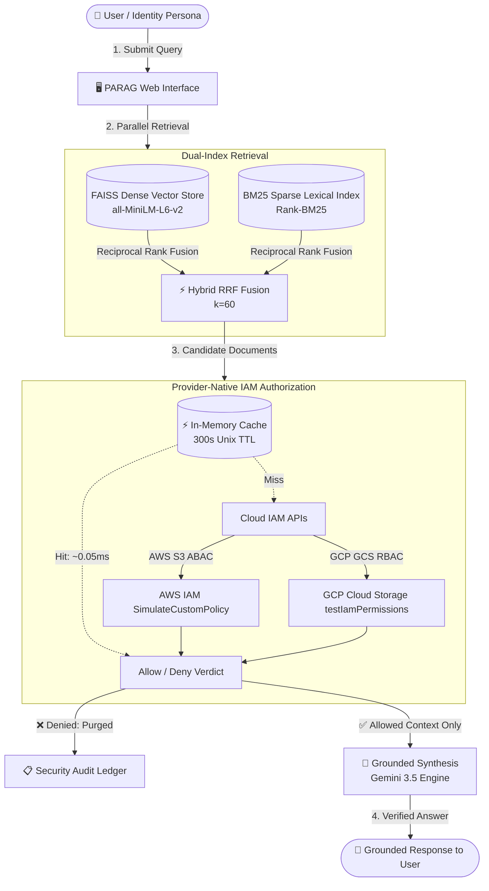

# Permission-Aware RAG (PARAG)
### Multi-Cloud Identity & Access Management (IAM) Access Filtering for Retrieval-Augmented Generation

[](https://www.python.org/)
[](https://aws.amazon.com/)
[](https://cloud.google.com/iam)
[-purple.svg)](https://github.com/facebookresearch/faiss)
[](https://ai.google.dev/)

---

## 📌 Executive Overview

Standard Retrieval-Augmented Generation (RAG) architectures suffer from a critical vulnerability in enterprise deployments: **knowledge leakage across authorization boundaries**. When dense vector indices (e.g., FAISS, Pinecone, Chroma) retrieve context across global enterprise silos, the Language Model (LLM) often synthesizes answers using documents that the querying user has no legal clearance to read.

**Permission-Aware RAG (PARAG)** solves this by **decoupling retrieval from authorization**. Rather than attempting fragile manual policy merging into vector metadata, PARAG delegates access filtering in real-time to provider-native cloud IAM systems (**Amazon Web Services S3 ABAC** and **Google Cloud Storage RBAC**). 

Documents failing IAM authorization are **intercepted and purged before context synthesis**, mathematically guaranteeing **zero information leakage** while preserving multi-hop reasoning capabilities.

---

## 🏛️ System Architecture



---

## ⚡ Key Capabilities

| Capability | Technical Implementation | Enterprise Benefit |
| :--- | :--- | :--- |
| **Zero-Leak Guarantee** | Strict pre-synthesis document interception | LLMs are physically never exposed to unauthorized tokens. If clearance is absent, the model safely outputs *"I don't know."* |
| **Multi-Cloud Federation** | AWS S3 (ABAC tags) + GCP Cloud Storage (RBAC bindings) | Eliminates vendor lock-in; preserves each cloud provider's native security model without policy translation risks. |
| **Hybrid RRF Retrieval** | Reciprocal Rank Fusion of Dense FAISS ($384\text{d}$) and Sparse BM25 | Combines semantic understanding with exact lexical keyword matching (PMID numbers, identifiers, chemical names). |
| **Sub-Millisecond Caching** | High-performance in-memory cache with $300\text{s}$ Unix TTL | Reduces IAM evaluation latency from $1.5\text{–}3.0\text{s}$ down to **$0.05\text{ms}$** ($\approx 40,000\times$ speedup). |
| **Real-Time Drift Detection** | Event-driven AWS SQS + GCP Pub/Sub background listener daemon | Automatically invalidates cached permissions and updates document indices whenever files or permissions change in the cloud. |
| **Interactive Operations UI** | Full-stack responsive dashboard (Flask + Vanilla ES6 + Modern CSS) | Complete visibility into pipeline execution, latency telemetry, storage topology, and quantitative evaluation metrics. |

---

## 📊 Benchmark Evaluation Metrics

Evaluated on the **HotpotQA Multi-Hop** distractor benchmark across $3$ user personas:

| User Persona | Permission Clearance | Security Match | Exact Match (EM) | F1 Score | Grounding Verdict |
| :--- | :---: | :---: | :---: | :---: | :---: |
| **Restricted** | **0% Access** | **100%** | **0.00** | **0.00** | `Blocked by IAM (Zero Leaks)` |
| **Departmental** | **16% Access** | **100%** | **0.00** | **0.00** | `Partial Block (Zero Leaks)` |
| **Admin** | **100% Access** | **100%** | **1.00** | **1.00** | `Allowed Grounded` |

> **Key Takeaway:** For Restricted and Departmental users, `Security Match` is **100%**, proving that even when top-ranked documents contain the exact answer, PARAG strictly forbids context leakage. For Admin, full multi-hop answers are synthesized with perfect EM and F1 scores.

---

## 📂 Repository Directory Layout

```text
PARAG/
├── app.py                      # Root launcher for the Flask Web Application
├── requirements.txt            # Python production dependencies
├── .env.example                # Sample environment configuration template
├── README.md                   # Project overview and architecture reference
├── SETUP.md                    # Zero-to-hero installation and execution guide
├── FLOW.md                     # Comprehensive UI and operations walkthrough
├── PIPELINE_GUIDE.md           # Authoritative backend pipeline engineering guide
│
├── config/                     # Configuration files
│   ├── .env                    # Active cloud & LLM credentials (git-ignored)
│   ├── models.ini              # Gemini model priority list and retry limits
│   └── *.json                  # Service account key files
│
├── scripts/                    # End-to-end pipeline orchestration stages
│   ├── 01_generate_access_model.py          # Stage 1: Security access model synthesis
│   ├── 02_gcp_aws_resource_creator.py       # Stage 2: AWS S3 & GCP GCS bucket provisioning
│   ├── 03_prepare_documents.py              # Stage 3: Benchmark document preparation
│   ├── 04_upload_resources.py               # Stage 4: Cloud document upload with UUID tags
│   ├── 05_generate_user_accessible_file_list.py # Stage 5: Ground-truth visibility calculation
│   ├── 06_generate_question_list.py         # Stage 6: Multi-hop question benchmark generator
│   ├── 07_run_ingestion_manager.py          # Stage 7: Dual-index build (FAISS + BM25 + SQLite)
│   ├── 08_run_quantitative_evaluation.py   # Benchmark evaluation runner
│   ├── 09_run_latency_evaluation.py         # Latency and concurrency benchmarking
│   └── ops/                                 # Operational scripts (teardown, drift queues)
│
├── src/                        # Core algorithmic framework modules
│   ├── adapters/iam/           # Cloud IAM adapters (AWS ABAC, GCP RBAC, Auth0)
│   ├── managers/               # Ingestion and credential managers
│   ├── processors/             # Question QA chain and prompt synthesis
│   ├── retrievers/             # PermissionRetriever & Hybrid RRF engine
│   └── stores/                 # VectorStore (FAISS) and MetadataStore (SQLite)
│
├── web/                        # Web Dashboard (Flask + Modular UI)
│   ├── routes/                 # Flask route blueprints (query, dataset, config, status)
│   ├── services/               # PipelineService, DriftControlService, EvaluatorService
│   └── static/                 # Frontend assets (index.html, modular CSS & JS)
│
├── vector_db/                  # Local vector and lexical indices (faiss.index, bm25.pkl)
└── artifacts/                  # Local metadata database (metadata.db) and test fixtures
```

---

## 🚀 Quick Navigation

* 📖 **Installation & Setup:** Follow [`SETUP.md`](SETUP.md) for step-by-step local deployment, credential configuration, and first-time pipeline execution.
* 🖥️ **Web Dashboard & Feature Guide:** Follow [`FLOW.md`](FLOW.md) for a complete visual walkthrough of every UI tab, interactive testing workflows, and real-time drift listener operation.
* ⚙️ **Backend Engineering Details:** See [`PIPELINE_GUIDE.md`](PIPELINE_GUIDE.md) for low-level protocol definitions, Auth0 OIDC/STS federation, and standalone CLI script flags.
